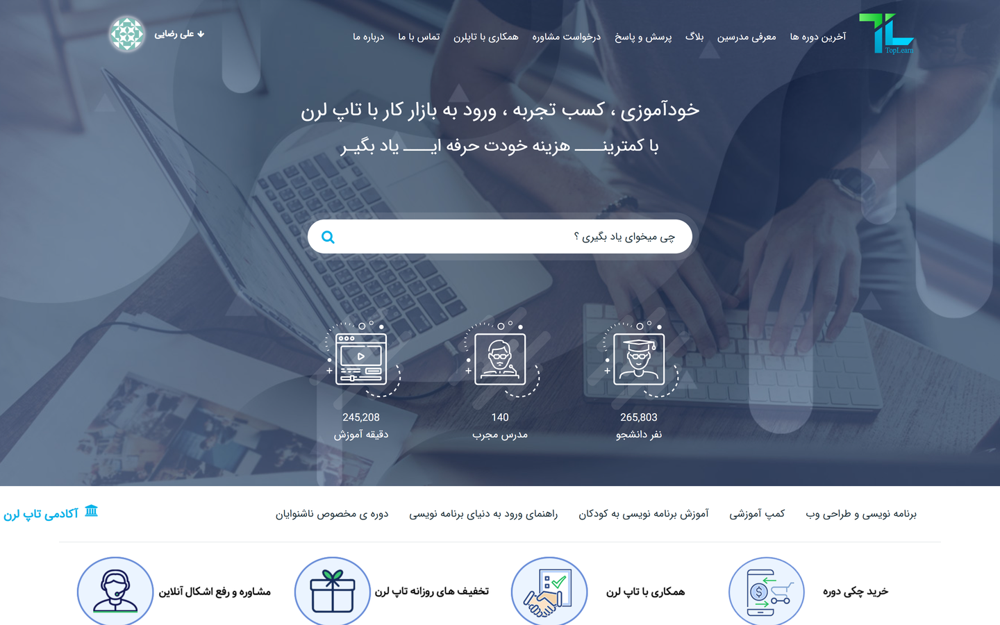
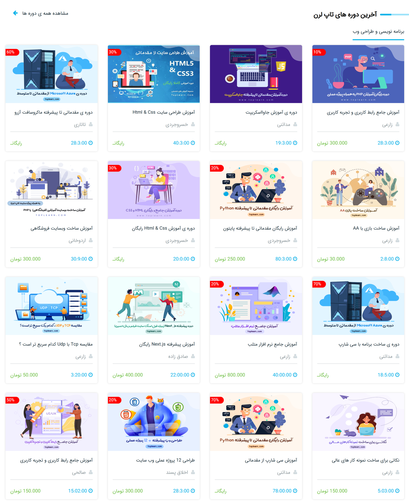
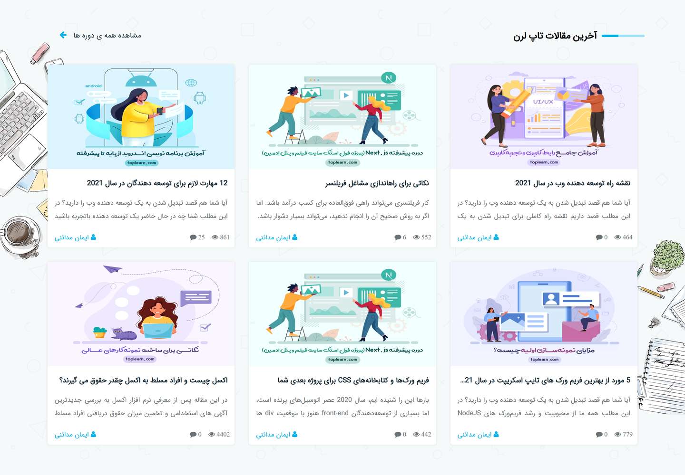
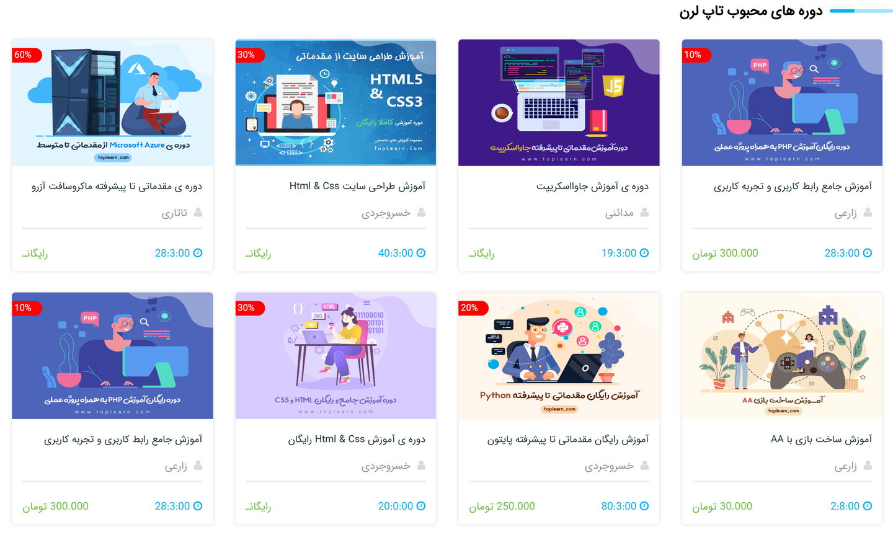
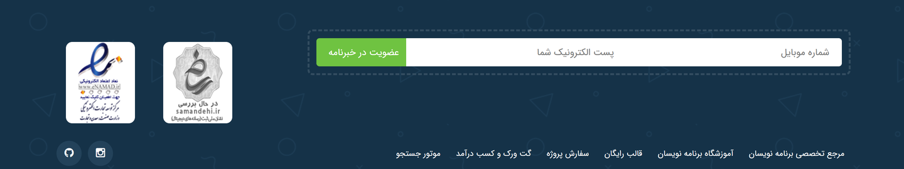
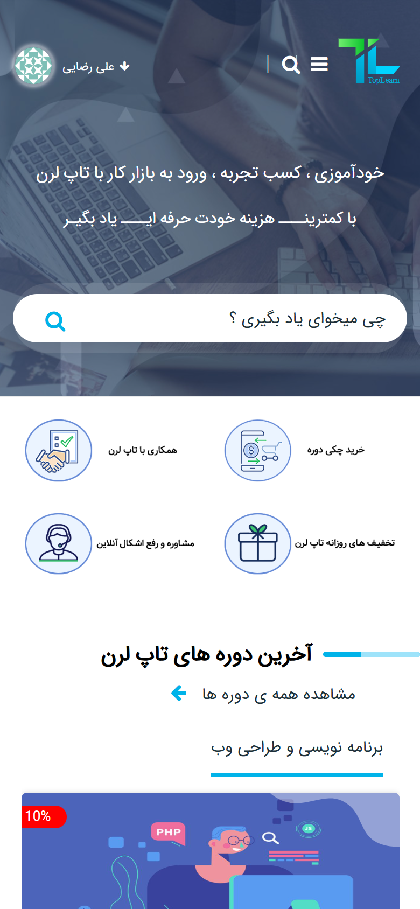

# 🎓 TopLearn Landing Page

**TopLearn** – A complete and fully responsive **RTL landing page** for an online programming academy, built with **HTML, SCSS and Vanilla JavaScript**.
Designed with **clean spacing, a real RTL layout, a full-width photo hero, smooth hover states and hand-written responsive breakpoints**, perfect for portfolio showcase.

> ⚡ **Portfolio-Level Project** – Showcasing Senior Front-End expertise in **RTL interfaces, landing page structure, reusable SCSS components and responsive layout design**.

---

## 🛠 Tech Stack


---

## ✨ Key Features

- 🎬 **Full-Width Photo Hero** – 700px hero with a cover background, headline, sub-headline and a centered course search box
- 🧭 **Mega Navbar** – Eight main links (courses, instructors, blog, Q&A, consultation, collaboration, contact, about) plus an academy button
- 👤 **Profile Dropdown** – Avatar menu with account, edit profile, password, wallet, invoices, tickets and logout, toggled in Vanilla JS
- 🔍 **Course Search** – Prominent hero search input for "what do you want to learn?"
- 📊 **Academy Stats** – Three icon stats for students, instructors and total minutes of training
- 🧩 **Quick Access Tabs** – Category strip above the content for fast navigation between tracks
- 🎁 **Promo Banners** – Four illustrated quick-action banners for purchase, collaboration, discounts and online support
- 📚 **Latest Courses Grid** – Fifteen course cards with cover, discount badge, instructor, price and duration
- 🗂 **Suggested & Popular Courses** – Two extra course rows with their own compact card layout
- 📰 **Blog & Articles Band** – Six article cards with fixed side artwork, hover overlay button, view and comment counters
- 📬 **Newsletter & Footer** – Phone and email subscribe form, trust badges, six footer links and Instagram / GitHub icons
- 🎨 **SCSS Architecture** – Color tokens, font settings, four reusable mixins and nested BEM-style component blocks
- 🇮🇷 **Persian First** – Full RTL layout, Persian digits and self-hosted IRANSansWeb typography
- 📱 **Fully Responsive** – Hand-written breakpoints at 1280, 1200, 992, 768, 576 and 444px
- ⚡ **No Build Step To Run** – Plain HTML, CSS and JavaScript; the SCSS is already compiled into `Main.min.css` and `Media.min.css`

---

## 📸 Visual Preview

<div align="center">

### 🏠 Hero & Header

*Full-width photo hero with the mega navbar, search box and academy stats.*



---

### 📚 Latest Courses

*Fifteen course cards with covers, discount badges, instructors, prices and durations.*



---

### 📰 Blog & Articles

*Article cards with their own artwork, hover overlay button and view / comment counters.*



---

### 🔥 Popular Courses

*The popular courses row with its own compact card grid.*



---

### 📬 Newsletter & Footer

*Subscribe form with trust badges, footer links and social icons.*



---

### 📱 Mobile

*Off-canvas burger menu, stacked banners and single-column course cards.*



</div>

---

## 🗂 Page Sections

| Section | What it does |
| --- | --- |
| Header & Hero | Navbar, profile dropdown, headline, course search and academy stats |
| Quick Access | Category strip linking the main learning tracks |
| Promo Banners | Four illustrated shortcuts for purchase, collaboration, discounts and support |
| Latest Courses | Fifteen course cards with discount badge, instructor, price and duration |
| Suggested Courses | A compact row of recommended courses |
| Blog & Articles | Six article cards with hover action, views and comments |
| Popular Courses | The most-viewed courses row |
| Newsletter & Footer | Subscribe form, trust badges, footer links, social icons and copyright |

---

## 🧩 Project Structure

| Path | Description |
| --- | --- |
| `index.html` | The whole landing page markup: header, hero, course grids, articles, newsletter and footer |
| `sass/Main.scss` | Color tokens, fonts, mixins, layout and every component state |
| `sass/Media.scss` | Hand-written responsive rules for each breakpoint |
| `css/Main.min.css` | Compiled main stylesheet |
| `css/Media.min.css` | Compiled responsive stylesheet |
| `css/font-awesome.css` | Self-hosted Font Awesome 4.7 icon set |
| `Fonts` | Self-hosted IRANSansWeb, Raleway and Font Awesome webfonts |
| `Image` | Course covers, article artwork, banners, logos and readme screenshots |

---

## ⚙️ How It Works

1. Land on the hero and search for a course, or jump straight to a quick-access category
2. Scan the latest courses grid and check each card's discount, instructor, price and duration
3. Hover an article image to reveal the "read full article" overlay button
4. Compare the suggested and popular rows to pick a track
5. Subscribe with a phone number and email in the newsletter band, then use the footer or social links to get in touch

---

## 🚀 Setup

```bash
git clone https://github.com/condev-dev/toplearn.git
cd toplearn
open index.html
```

No install, no build, no dependencies. Just open `index.html` in a browser.
The SCSS sources are already compiled — only re-compile them if you edit `sass/Main.scss` or `sass/Media.scss`.

---

## 📄 License

[](LICENSE)

**© ConDev** – All rights reserved.
